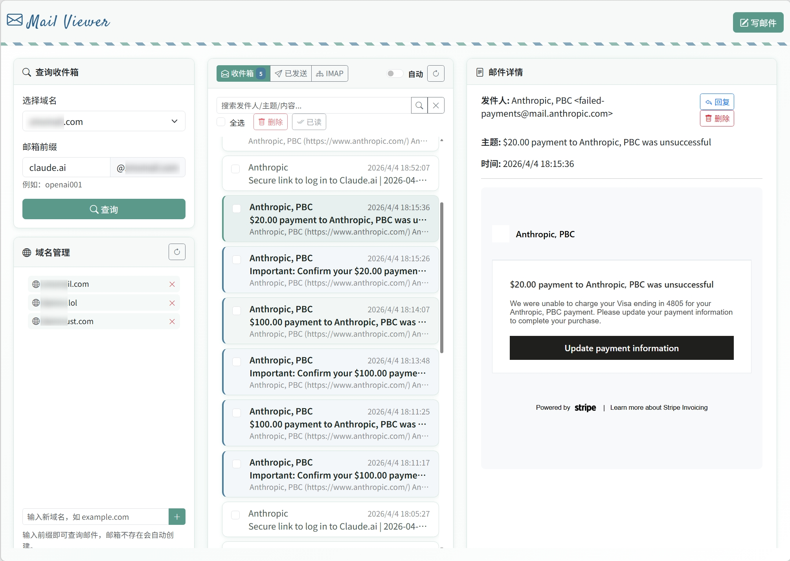

# ManyMail

Lightweight self-hosted email server: SMTP, webmail, forwarding rules and a REST API in one Go binary with SQLite. Disposable / temp mail and multi-domain inboxes without Postfix or Mailcow.

<div align="center">


**One container, about 10 MB of RAM — SMTP receiver, webmail, rules, REST API**

[](https://go.dev)
[](https://sqlite.org)
[](https://docs.docker.com/compose/)
[](LICENSE)
[](https://github.com/margbug01/ManyMail/stargazers)

**[Website](https://margbug01.github.io/ManyMail/)** · **[中文文档](README_CN.md)**

---



<sub>*All emails shown in the screenshot are for testing purposes only and have no real-world significance.*</sub>

</div>

## Why ManyMail

Mailcow, docker-mailserver and Mail-in-a-Box are full mail platforms. ManyMail is a small server for **inboxes you host yourself**: verification-code mail, disposable addresses, and a few domains — with a browser UI and an API.

| You want | Use |
|:---------|:----|
| Catch-all / temp addresses on your own domain | ManyMail |
| Webmail + REST API + forwarding rules, one compose file | ManyMail |
| Small VPS or ARM box, no Postfix/Dovecot | ManyMail |
| Company mail, IMAP for desktop clients, CalDAV, ActiveSync, Rspamd | Mailcow / docker-mailserver / Mail-in-a-Box |

## Features

- **Self-hosted SMTP** — receive mail for your domains on port 25 (STARTTLS optional); a built-in DNS check tells you which MX, SPF and DMARC records are missing
- **Webmail** — search, read, reply, compose and send through Resend; incoming HTML is sanitized and remote images stay blocked until you load them
- **External mailboxes** — an optional bridge shows Gmail, Outlook, QQ, 163 and other IMAP accounts in the same web UI
- **REST API** — DuckMail-compatible endpoints for scripts and disposable-mail tools
- **Forwarding and push rules** — forward to Gmail/QQ via Resend, push to ntfy, Telegram or a webhook, tag / mark read / trash by recipient, sender or subject; rules run the moment mail arrives and are edited on a Rules page ([docs](docs/mail-router.md))
- **Multi-domain** — any number of domains; mailboxes can be created on first use
- **Small** — one static binary (~15 MB), one SQLite file, ~10 MB of RAM in use; prebuilt amd64 / arm64 images on GHCR. MIT licensed, data stays on your server

## Overview

Three containers in one compose file:

| Container | Stack | Port | Description |
|:----------|:------|:-----|:------------|
| **manymail** | Go + SQLite | `:25` `:8080` `:5000` | SMTP receiver, REST API, web UI and rules engine |
| **imap-bridge** | Node.js + imapflow | `:3939` (internal) | Optional: external IMAP accounts in the web UI |
| **caddy** | Caddy 2 | `:80` `:443` | HTTPS with automatic certificates |

<br>

## Architecture

```
    Internet                              Your Server
    ────────                              ───────────
                      ┌────────────────────────────────────────────────┐
   Incoming     ──────┤►  manymail (one Go process)                    │
   Email              │   ┌──────────────┐   ┌───────────────────────┐ │
   (SMTP :25)         │   │ SMTP receiver│──►│ SQLite                │ │
                      │   │ Rules engine │◄─►│ mail, attachments,    │ │
                      │   │ REST API     │   │ accounts, rules       │ │
                      │   │ Web UI       │   └───────────────────────┘ │
                      │   └──────▲───────┘                             │
   Browser    ──► Caddy (HTTPS) ─┘   ▲ new-mail events                 │
                      │              │                                 │
                      │   imap-bridge (Node.js) ──► Gmail / Outlook /  │
                      │                             QQ / 163 ...       │
                      └────────────────────────────────────────────────┘
```

<br>

## Quick Start

You need a Linux server (amd64 or arm64) with Docker, a public IPv4 with inbound TCP 25, 80
and 443 open, and a domain whose DNS you control.

```bash
curl -fsSL https://raw.githubusercontent.com/margbug01/ManyMail/master/install.sh | bash
```

The installer asks for your mail domain(s), the host name for the web UI (default
`mail.<domain>`), a password (or generates one) and how long to keep mail. It writes `.env`
with random secrets, pulls the prebuilt images from GHCR (`linux/amd64` and `linux/arm64`),
starts everything, and finishes with a DNS check that prints the records still missing.

Unattended: `MANYMAIL_DOMAINS=example.com ./install.sh --yes`. All options are listed at the
top of [`install.sh`](install.sh).

### Manual setup

```bash
git clone https://github.com/margbug01/ManyMail.git && cd ManyMail
cp .env.example .env     # DOMAINS, SMTP_HOSTNAME, MAIL_WEB_HOST, secrets, ACCESS_PASSWORD
docker compose up -d     # pulls images; add --build to build from this checkout
```

For production, review [`docs/production-hardening.md`](docs/production-hardening.md). The
server refuses to start in `ENVIRONMENT=production` while a secret is left at its default.

### Check

```bash
docker compose ps
docker compose exec -T manymail manymail dnscheck   # also at https://<web host>/dns-check
curl http://127.0.0.1:8080/health
```

### Update

```bash
git fetch --depth 1 origin tag vX.Y.Z && git checkout vX.Y.Z
sed -i 's/^MANYMAIL_VERSION=.*/MANYMAIL_VERSION=X.Y.Z/' .env
docker compose pull && docker compose up -d
```

### Upgrading from 1.x (MongoDB)

Version 2 replaces the Python services and MongoDB with one Go binary and SQLite. The `.env`
stays as it is. Export the data **before** pulling the new version, while MongoDB still runs:

```bash
mkdir -p export
for c in domains accounts messages sent_messages sender_keys routing_rules routing_events; do
  docker compose exec -T mongodb mongoexport --quiet --db mailserver --collection "$c" > "export/$c.json"
done
git pull                                   # or check out the 2.x tag
docker compose run --rm -v "$PWD/export:/export:ro" manymail import /export
docker compose up -d --remove-orphans      # removes the old mail-service, mail-viewer, router, imap-server, mongodb
```

Message ids, mailbox passwords, Resend keys saved in the web UI and rules carry over; imported
mail is not forwarded again. The IMAP server for desktop clients (port 993) is gone in 2.x.
Once everything looks right, remove the old MongoDB volume with `docker volume rm`.

<br>

## DNS Setup

Receiving needs two records; the other two are recommended:

```dns
; Required: where other servers deliver mail, and the host they connect to
yourdomain.com.         IN  MX   10  mail.yourdomain.com.
mail.yourdomain.com.    IN  A        <your-server-ip>

; Recommended: nobody may send as this domain
; (if you send through Resend, publish the SPF record Resend shows instead)
yourdomain.com.         IN  TXT      "v=spf1 -all"

; Recommended: DMARC policy
_dmarc.yourdomain.com.  IN  TXT      "v=DMARC1; p=quarantine; rua=mailto:dmarc@yourdomain.com"
```

ManyMail does not sign outgoing mail, so there is no DKIM key to generate here. Replies and
forwards go out through Resend; add the DKIM and SPF records Resend lists for your domain.

The DNS self-check (`/dns-check` in the web UI, or `manymail dnscheck`) looks up MX, the MX
host's address, the web host, SPF and DMARC through public resolvers and prints the exact
record to add for anything missing.

> **STARTTLS**: put the certificate and key in `./certs` (mounted read-only) and set `SMTP_TLS_CERT` / `SMTP_TLS_KEY` in `.env`. See `.env.example`.

<br>

## API Reference

> Base URL: `http://127.0.0.1:8080`
>
> Auth: `Authorization: Bearer <token>` for mailbox endpoints; `X-API-Key: <API_KEY>` for `/admin/*`

### Account

```http
POST /accounts                              # Create mailbox account
POST /token                                 # Login, returns JWT (24h)
```

### Messages

```http
GET    /messages                            # Inbox (paginated: ?offset=0&limit=30)
GET    /messages/{id}                       # Message detail, marks it read
GET    /messages/{id}/attachments/{aid}     # Download an attachment
GET    /messages/search?q=                  # Search subject, sender and body
DELETE /messages/{id}                       # Move to trash
GET    /messages/trash                      # Trash
POST   /messages/{id}/restore               # Restore from trash
DELETE /messages/{id}/permanent             # Delete for good
POST   /messages/batch                      # {"action": "delete|mark_read|restore|permanent_delete", "ids": [...]}
GET    /sent                                # Sent messages
```

### System

```http
GET  /health                                # Health check (no auth)
GET  /domains                               # Active domains
GET  /admin/domains · POST · DELETE /{d}    # Manage domains (API key)
GET  /admin/dns-check                       # DNS self-check (API key)
```

The rules API (list, edit, dry-run, test) lives under `/router/*` with the API key; see
[docs/mail-router.md](docs/mail-router.md).

<details>
<summary><strong>Example: Create account & read inbox</strong></summary>

```bash
# Create account
curl -X POST http://127.0.0.1:8080/accounts \
  -H "Content-Type: application/json" \
  -d '{"address": "user@yourdomain.com", "password": "secret123"}'

# Get token
TOKEN=$(curl -s -X POST http://127.0.0.1:8080/token \
  -H "Content-Type: application/json" \
  -d '{"address": "user@yourdomain.com", "password": "secret123"}' \
  | jq -r '.token')

# List messages
curl http://127.0.0.1:8080/messages \
  -H "Authorization: Bearer $TOKEN"
```

</details>

<br>

## Project Structure

```
ManyMail/
├── main.go                 # Config (.env) and startup; `manymail import`, `manymail dnscheck`
├── smtpd.go, parse.go      # SMTP receiver and MIME parsing
├── store.go, routestore.go # SQLite schema and queries
├── api.go                  # DuckMail-compatible REST API
├── viewer.go, sanitize.go  # Web UI, HTML sanitizer, image proxy, sending via Resend
├── rules.go, router.go     # Forwarding / push rules and the rules API
├── dnscheck.go             # MX / SPF / DMARC self-check
├── migrate.go              # Import from a 1.x MongoDB export
├── web/                    # Templates and front-end files, embedded into the binary
├── frontend/               # Main mail UI (SolidJS + TypeScript, Vite) → web/static/app
├── imap-bridge/            # Optional Node.js bridge to external IMAP accounts
├── i18n/                   # UI translations (tools/build-i18n.cjs bundles them)
├── Dockerfile              # Node builds the UI, Go builds the binary → alpine, runs as uid 10001
├── docker-compose.yml      # manymail + imap-bridge + caddy
├── install.sh              # Interactive installer
└── tools/                  # UI tests, deploy script, test senders
```

<br>

## Security

| Layer | Feature |
|:------|:--------|
| **Auth** | JWT tokens (24h expiry) + API key for admin endpoints |
| **Password** | bcrypt hashing |
| **Rate Limit** | Per-IP throttling on API, SMTP, web login, auto-create, domain admin, mail changes and sending |
| **SMTP** | IP / sender blacklist, greylist, recipient and size limits, optional STARTTLS, auto-reply loop guard |
| **Email Render** | Whitelist HTML/CSS sanitizer, sandboxed iframe, remote images only on request |
| **Network** | Image proxy checks every connection and redirect against private addresses |
| **Storage** | One SQLite file; optional cleanup after `MESSAGE_TTL_DAYS` (default 3, `0` keeps mail forever) |
| **External IMAP** | Saved accounts are encrypted with `IMAP_ACCOUNT_ENCRYPTION_KEY` |
| **Web** | Login-protected UI, HttpOnly session cookies, JSON-only APIs, changing `ACCESS_PASSWORD` ends all sessions |

Additional hardening guidance: [`docs/production-hardening.md`](docs/production-hardening.md).

<br>

## Tech Stack

| Component | Built with |
|:----------|:-----------|
| manymail | Go 1.27 · `emersion/go-smtp` · `modernc.org/sqlite` (pure Go, no cgo) · `golang.org/x/net/html` · `x/crypto/bcrypt` |
| web UI | SolidJS 2 (RC) · TypeScript · Vite (build time only) · Bootstrap 5 · Quill |
| imap-bridge | Node.js 20 · `express` · `imapflow` · `mailparser` |
| HTTPS | Caddy 2 |

<br>

## Community

ManyMail appreciates [linux.do](https://linux.do/) — a friendly Chinese tech community where people share ideas, projects, and practical self-hosting experience.

<br>

## Changelog

[CHANGELOG.md](CHANGELOG.md) — see also the [releases](https://github.com/margbug01/ManyMail/releases).

## License

[MIT](LICENSE)

---

<div align="center">
<sub>Built for self-hosting. Own your email infrastructure.</sub>
</div>
